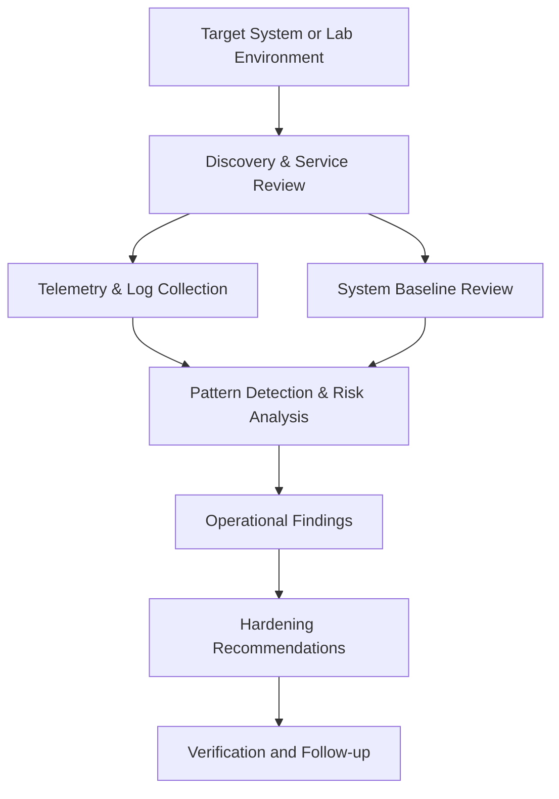

# Architecture Overview

## Core layers

### 1. Discovery layer
This layer focuses on what is visible to the outside world: open ports, exposed services, service banners, and initial host posture.

### 2. Telemetry layer
This layer captures the operational and log-based signals that help explain what is happening inside the system or environment.

### 3. Defensive layer
This layer monitors ongoing drift, integrity changes, and suspicious events. It represents the monitoring side of a practical security workflow.

### 4. Analytics layer
This layer converts observations into summaries and risk patterns that are easier to understand and act on.

### 5. Evidence and reporting layer
This layer turns the raw signal into written findings, recommendations, and research notes.

## Design philosophy

The architecture is intentionally modular. A good lab or research repo should make it easy to reason about each stage without mixing discovery, detection, and reporting into one giant script.
